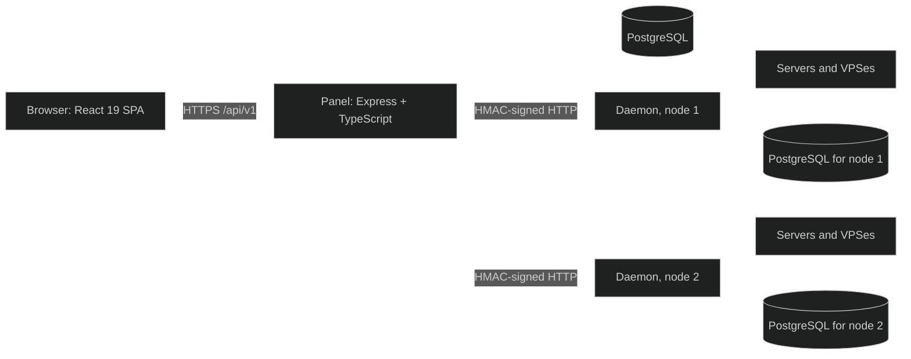
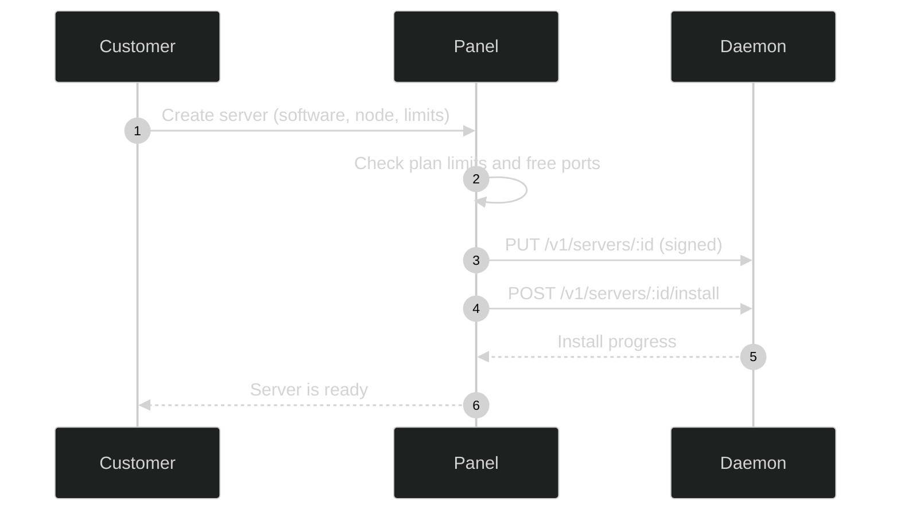

MonoPanel is a hub-and-spoke system. The panel is the hub, every node runs one daemon, and the panel is the only thing that ever talks to a daemon.

## Panel

The panel serves the single-page app and the JSON API under `/api/v1/`. It handles accounts, sessions, billing, tickets, mail, the admin panel and the Discord bot and webhooks. Everything it stores lives in PostgreSQL. It keeps its working set in memory and writes only the changed rows, so only one panel process may use a database.

## Daemon

Each node runs one daemon on one port with one shared secret. A single daemon serves both customer servers (`/v1/servers/*`) and customer VPSes (`/v1/vps/*`). It keeps its own state in its own PostgreSQL database.

## How they talk

Every request the panel sends to a daemon is HMAC-signed with a timestamp and a single-use nonce. The browser never talks to a node: the live console, file manager and every other node feature go through the panel, so node addresses and secrets stay private. See [Daemon security](/docs/daemon/security/).

## Creating a server

## Payments

Payments are handled entirely inside the panel. A customer places an order or adds credits, the order waits in the Orders and Billing queue, and staff verify the payment before credits are granted. See [Billing](/docs/features/billing/).
